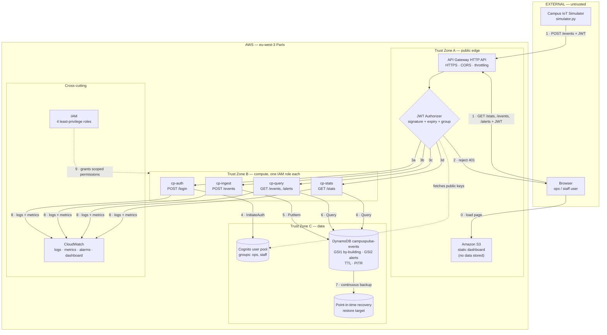

# Architecture Diagram — CampusPulse 2026

Three representations of the same system: an ASCII overview you can read in a terminal, a Mermaid diagram that renders in GitHub and can be exported for the submission, and a numbered explanation of every single connection.

---

## 1. Text architecture

```text
   EXTERNAL / UNTRUSTED                         AWS CLOUD — Region: eu-west-3 (Paris)
 ..............................  .........................................................
 :                            :  :                                                       :
 :   [ Campus IoT Simulator ] :  :   TRUST ZONE A — PUBLIC EDGE                           :
 :     simulator.py (laptop)  :  :   +-----------------------------------------------+   :
 :     occupancy, temp,       :--1->|        Amazon API Gateway (HTTP API)            |   :
 :     humidity, energy,      :  :  |   HTTPS only  ·  CORS  ·  stage throttling      |   :
 :     equipment, requests    :  :  |   JWT Authorizer  --2-->  validates every token |   :
 :                            :  :  +------+--------+---------+---------+------------+   :
 :   [ Browser — ops / staff ]:  :         |3a      |3b       |3c       |3d              :
 :     dashboard (HTML/JS)    :--1->       v        v         v         v                :
 :                            :  :   TRUST ZONE B — COMPUTE (one IAM role per function)   :
 :............................:  :  +---------+ +---------+ +---------+ +---------+      :
                                 :  | cp-auth | | cp-     | | cp-     | | cp-     |      :
        [ Static dashboard ]     :  |         | | ingest  | | query   | | stats   |      :
         served from S3 <--0-----:--|  login  | | validate| | read    | |aggregate|      :
                                 :  +----+----+ +----+----+ +----+----+ +----+----+      :
                                 :       |4         |5           |6         |6           :
                                 :       v          v            v          v            :
                                 :  +---------+   +--------------------------------+     :
                                 :  | Cognito |   |  TRUST ZONE C — DATA           |     :
                                 :  |  user   |   |  Amazon DynamoDB               |     :
                                 :  |  pool   |   |  campuspulse-events            |     :
                                 :  | groups: |   |  + GSI1 by-building            |     :
                                 :  | ops,    |   |  + GSI2 alerts (sparse)        |     :
                                 :  | staff   |   |  + TTL  + PITR --7--> backup   |     :
                                 :  +---------+   +--------------------------------+     :
                                 :                                                       :
                                 :   CROSS-CUTTING                                       :
                                 :  +-----------------------------+   +---------------+  :
                                 :  | Amazon CloudWatch      <-8--|   | AWS IAM       |  :
                                 :  | logs · metrics · alarms     |   | 4 exec roles  |  :
                                 :  | dashboard                   |   | least priv. 9 |  :
                                 :  +-----------------------------+   +---------------+  :
                                 :.......................................................:

  Legend:  ---->  request/response over HTTPS     ....  trust boundary
```

## 2. Mermaid diagram



## 3. Every connection, explained

| # | From → To | Protocol / call | What travels | Why it exists | What breaks without it |
|---|---|---|---|---|---|
| **0** | Browser → S3 | HTTPS GET | HTML, CSS, JS — **no campus data** | Somewhere has to serve the page. S3 does it with no server to run | No dashboard UI; the API still works for `curl` |
| **1** | Simulator / Browser → API Gateway | HTTPS POST/GET with `Authorization: Bearer <JWT>` | One JSON event, or a query | Single controlled public entry point to the system | Nothing can reach the backend |
| **2** | API Gateway JWT Authorizer → caller | HTTP 401 | Rejection | Invalid, expired or missing tokens are stopped **before our code runs**, so a bad token costs us no Lambda time | Every request would reach our functions and we'd pay to reject them |
| **3a-3d** | API Gateway → Lambda | AWS SDK invoke (event payload) | Request as a JSON event object, including the verified token claims | Routes each path to the one function that handles it | That route returns 404/502 |
| **4** | `cp-auth` → Cognito | `InitiateAuth` API call | Username + password in, ID/access/refresh tokens out | Turns credentials into a token. Our code never sees a stored password | No login; nothing else can be called |
| **(dotted)** | JWT Authorizer → Cognito | HTTPS | Public signing keys (JWKS) | Lets API Gateway verify a token's signature without contacting Cognito per request | Tokens could not be validated |
| **5** | `cp-ingest` → DynamoDB | `PutItem` | The validated, severity-classified event | Persistence. This is the only write path in the system | Events vanish; dashboard stays empty |
| **6** | `cp-query` / `cp-stats` → DynamoDB | `Query` (never `Scan`) | Key conditions in, matching items out | Reads for the dashboard | Dashboard has no data to show |
| **7** | DynamoDB → PITR | Managed, continuous | Change log | Lets us restore the table to any second in the retention window — our RPO | No recovery from an accidental delete |
| **8** | All Lambdas → CloudWatch | Automatic (stdout) + EMF metrics | Structured log lines, `EventsIngested`, `AlertsRaised` counters | How we debug, prove the system works, and trigger alarms | Blind operation; no evidence for the report |
| **9** | IAM → Lambdas | Role assumption at invoke | Temporary scoped credentials | Each function can do **only** its own job. No access keys anywhere | Functions could not reach DynamoDB at all, or worse, could reach everything |

## 4. Trust zones

| Zone | Contains | Who can reach it | Control enforcing that |
|---|---|---|---|
| **External** | Simulator, browsers | Anyone on the internet | — |
| **A — public edge** | API Gateway, S3 site | Anyone, but every data route requires a valid JWT | TLS, JWT authorizer, throttling, CORS |
| **B — compute** | The four Lambda functions | Only API Gateway can invoke them | Lambda resource policy + IAM |
| **C — data** | DynamoDB, Cognito | Only the specific Lambda with the matching role | IAM role per function, scoped to one resource and one action set |

Data crosses a boundary in exactly three places: the JWT check at the edge, the role check when a function touches data, and the group check inside the function. That is the whole security model, and every member of the team should be able to name all three.

## 5. Exporting for submission

The submission needs the diagram as PDF or an image (§13). The Mermaid block above renders on GitHub; for the final export we will render it and place the file at `docs/architecture/campuspulse-architecture.pdf`. **Not produced yet.**
