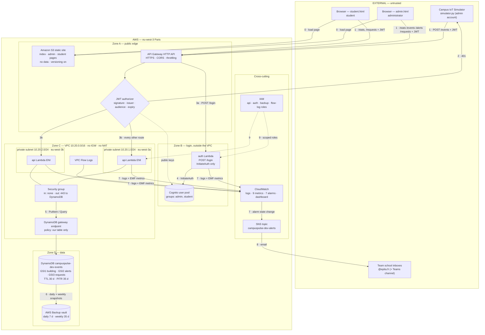

# Architecture Diagram — CampusPulse 2026

*Revised 12 October 2026 after the project review: VPC added, backups added, alerts emailed to the team, two role-specific pages, five Lambda functions reduced to two.*

Three representations of the same system: an ASCII overview you can read in a terminal, a Mermaid diagram that renders on GitHub, and a numbered explanation of every connection. The exported image for submission is `docs/architecture/campuspulse-architecture.png` (and `.pdf`).

---

## 1. Text architecture

```text
 EXTERNAL / UNTRUSTED                  AWS CLOUD — eu-west-3 (Paris)
 ....................   ...........................................................................
 :                  :   :  ZONE A — PUBLIC EDGE                                                   :
 : [Simulator]      :-1-:->+------------------------------------------------------+               :
 :  simulator.py    :   :  | API Gateway (HTTP API) · HTTPS · CORS · throttling   |               :
 :  (signs in as    :   :  | JWT authorizer --2--> 401 for a missing/bad token    |               :
 :   admin)         :   :  +--------+---------------------------------+-----------+               :
 :                  :   :           |3a POST /login                   |3b every other route       :
 : [Browser]        :-1-:->         v                                 v                           :
 :  index.html      :   :  ZONE B — LOGIN (no VPC)        ZONE C — VPC 10.20.0.0/16               :
 :  admin.html      :   :  +-------------------+          +------------------------------------+  :
 :  student.html    :   :  | auth Lambda       |          | private subnet A   private subnet B|  :
 :                  :   :  | InitiateAuth only |          | 10.20.1.0/24       10.20.2.0/24    |  :
 :..................:   :  | no data access    |          | eu-west-3a         eu-west-3b      |  :
        ^               :  +---------+---------+          |  +------------------------------+  |  :
        |0 pages        :            |4                   |  |  api Lambda (router)          |  |  :
  [S3 static site]      :            v                    |  |  ingest · query · stats ·     |  |  :
   3 pages, no data,    :  +-------------------+          |  |  requests · health            |  |  :
   versioning ON        :  | Cognito user pool |          |  +---------------+--------------+  |  :
                        :  | groups: admin,    |          |  SG: in none, out 443 -> DynamoDB  |  :
                        :  |         student   |          |  route table: no 0.0.0.0/0 route  |  :
                        :  +-------------------+          |  no Internet Gateway, no NAT      |  :
                        :                                 +------------------|5-----------------+  :
                        :                                   DynamoDB GATEWAY endpoint (free)       :
                        :                                   policy: PutItem/Query, our table only  :
                        :  ZONE D — DATA                                     v                     :
                        :  +-------------------------------------------------------------------+  :
                        :  | DynamoDB campuspulse-dev-events  GSI1 building · GSI2 alerts ·     |  :
                        :  | GSI3 requests-by-student · TTL 30 d · PITR 35 d --6--> AWS Backup  |  :
                        :  |                                       vault: daily 7 d, weekly 35 d |  :
                        :  +-------------------------------------------------------------------+  :
                        :  CROSS-CUTTING                                                          :
                        :  CloudWatch: logs · 9 metrics · 7 alarms --7--> SNS topic --8--> email   :
                        :  VPC Flow Logs                                   team @epita.fr inboxes  :
                        :  IAM: api role · auth role · backup role · flow-log role --9             :
                        :.........................................................................:

  Legend:  ---->  request/response over HTTPS      ....  trust boundary
```

## 2. Mermaid diagram



## 3. Every connection, explained

| # | From → To | Protocol / call | What travels | Why it exists | What breaks without it |
|---|---|---|---|---|---|
| **0** | Browser → S3 | HTTP GET (S3 website endpoint) | The three pages' HTML, CSS, JS — **no campus data** | Somewhere has to serve the pages; S3 does it with no server | No UI; the API still works for `curl` |
| **1** | Simulator / browser → API Gateway | HTTPS with `Authorization: Bearer <JWT>` | One JSON event, a service request, or a query | Single controlled public entry point | Nothing can reach the backend |
| **2** | JWT authorizer → caller | HTTP 401 | Rejection | Bad tokens stopped **before any Lambda runs** | We would pay to reject every forged request |
| **3a** | API Gateway → `auth` Lambda | Lambda invoke | `POST /login` body | Login is public by necessity | Nobody can obtain a token |
| **3b** | API Gateway → `api` Lambda | Lambda invoke via the Lambda service (not via the VPC network) | The request plus the verified token claims; `handlers/api.py` routes on `routeKey` | One function for every data route | All data routes fail |
| **4** | `auth` → Cognito | `InitiateAuth` | Credentials in, tokens out | Our code never stores or compares a password | No login |
| **5** | `api` → DynamoDB | `PutItem`, `Query` over HTTPS, through the **gateway endpoint** | Validated events in; matching items out (never `Scan`) | The only path out of the private subnets | Every data route returns 500 |
| **6** | DynamoDB → AWS Backup vault | Managed snapshot | Full table copy, daily and weekly | A backup that survives the table (PITR alone does not) | Deleting the table beyond the PITR window loses everything |
| **7** | Lambdas / Flow Logs → CloudWatch → SNS | stdout + EMF; alarm actions | Logs, 9 metric series; alarm state changes | Debugging, evidence, and turning a critical event into an alert | Blind operation; no alerts |
| **8** | SNS → team inboxes | Email | "ALARM: campuspulse-dev-critical-alert …" | Professor's requirement: alerts reach the team's school mail | Alerts visible only in the console |
| **9** | IAM → functions | Role assumption | Temporary scoped credentials | Each function can do only its job; no access keys anywhere | Functions reach nothing, or everything |

## 4. Trust zones

| Zone | Contains | Who can reach it | Control enforcing that |
|---|---|---|---|
| **External** | Simulator, browsers, team inboxes | Anyone | — |
| **A — public edge** | API Gateway, S3 site | Anyone, but every data route needs a valid JWT | TLS, JWT authorizer, throttling, CORS; S3 bucket read-only, no data |
| **B — login** | `auth` Lambda, Cognito | API Gateway only | Lambda resource policy; role allows `InitiateAuth` only — **no data** |
| **C — VPC** | `api` Lambda in two private subnets | API Gateway only (invocation through the Lambda service); **nothing inbound on the network** | Security group with no inbound rules; no IGW, no NAT, no default route |
| **D — data** | DynamoDB, backup vault | Only the `api` function, only through the gateway endpoint | IAM (`PutItem`/`Query` on one table) **and** endpoint policy (same table only) |

Data crosses a boundary in four places: the JWT check at the edge (401), the role check inside each route (403 — `admin` vs `student`), IAM when a function touches data (`AccessDenied`), and the network, which gives the data function exactly one destination.

## 5. Exported image

`docs/architecture/campuspulse-architecture.png` and `campuspulse-architecture.pdf`, rendered from `docs/architecture/campuspulse-architecture.html`.
