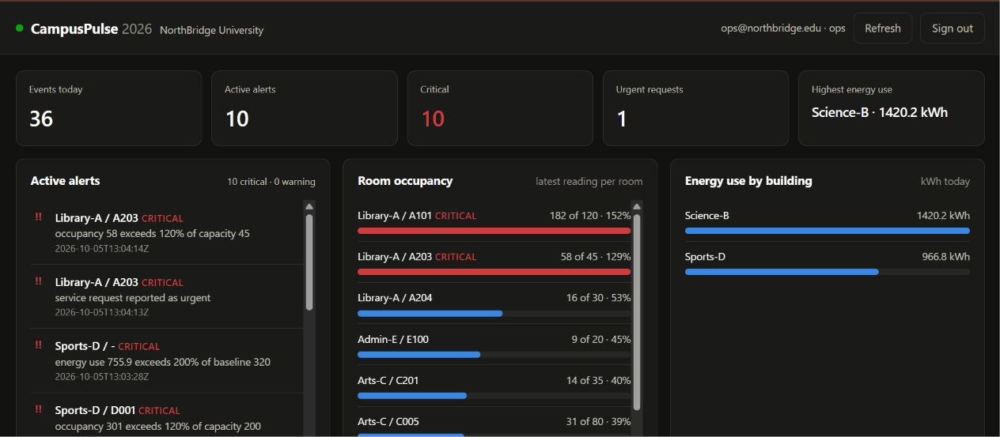
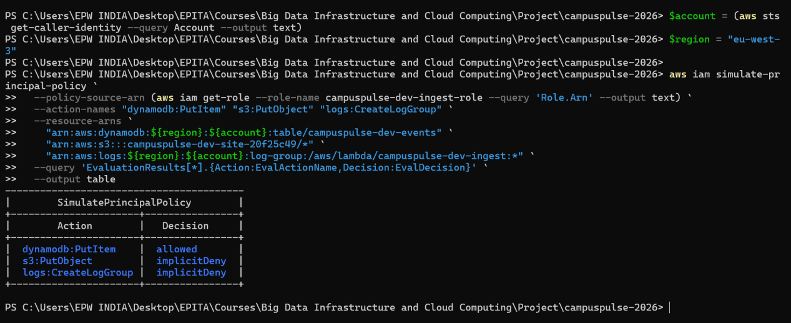
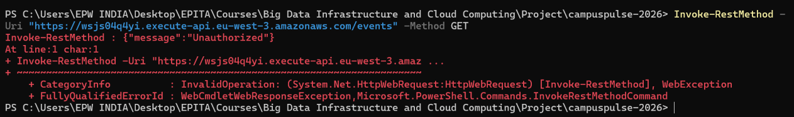
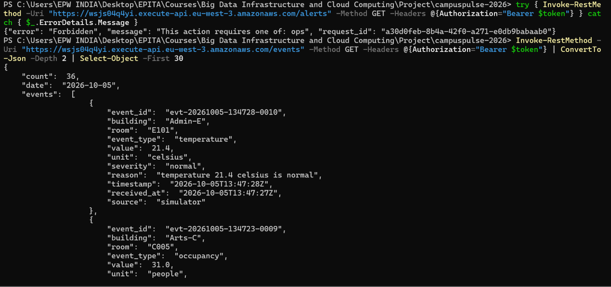
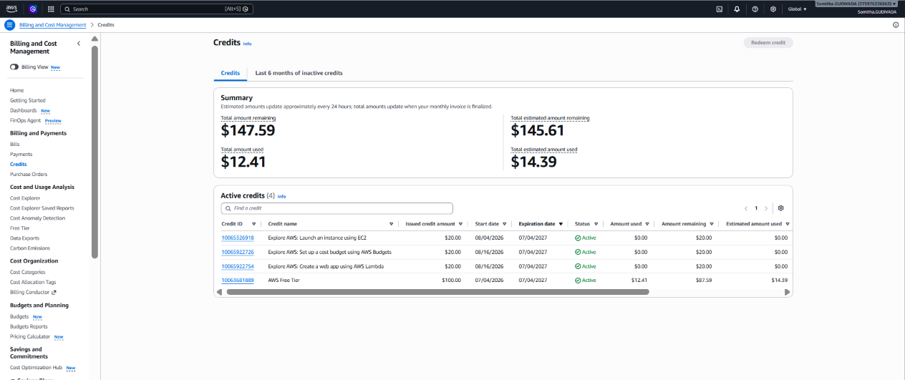
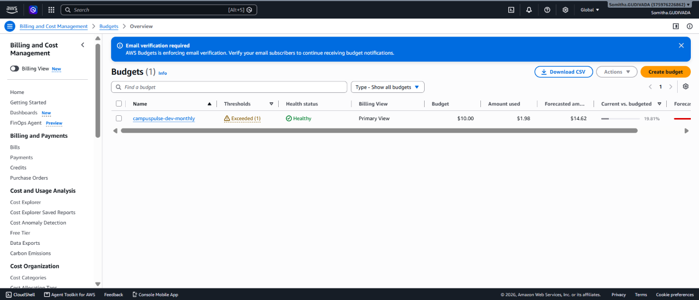
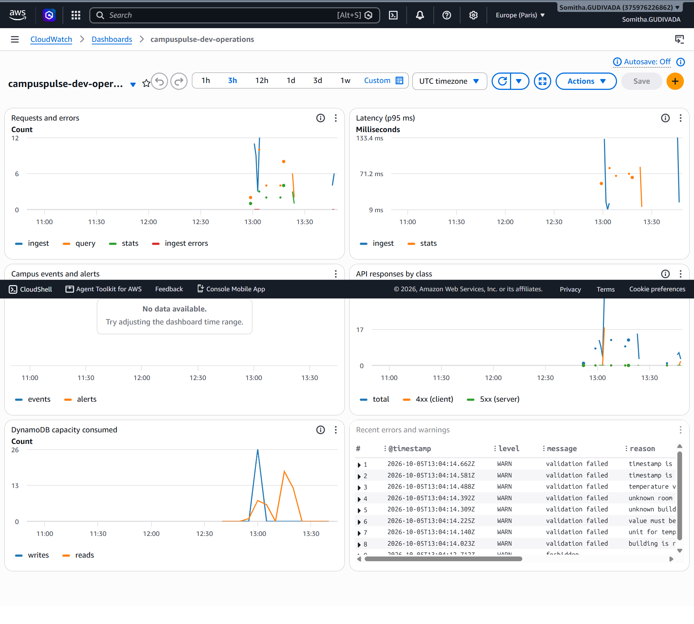
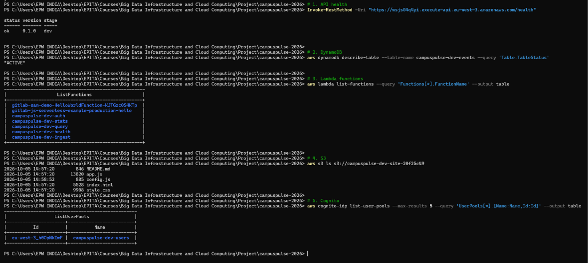

# CampusPulse 2026
## A Cloud-Native Smart Campus Operations Platform

**Implementation Report**

Big Data & Cloud Computing — Final Project S2 2026
EPITA, Academic Year 2025-2026

**Team:** Somitha Gudivada · Meha · Madhavan · MD
**Cloud provider:** Amazon Web Services · **Region:** eu-west-3 (Paris)
**Repository:** `https://github.com/SomithaG08/campuspulse-2026`
**Deployed API:** `https://wsjs04q4yi.execute-api.eu-west-3.amazonaws.com/`

> **Revision of 12 October 2026 — corrections from the project review.** The professor asked for five changes: (1) a VPC, (2) backups, (3) alerts sent to the team's school email, (4) two pages — one for administrators, one for students, and (5) fewer Lambda functions. All five are implemented in this version; what changed and why is summarised in §2.6 and in `docs/requirements/21-professor-corrections.md`. Screenshots marked *(5 Oct deployment)* were taken before the corrections and are kept as a record; the evidence for the corrected deployment is listed in §10.5.

---

## 1. Introduction

### 1.1 Problem definition

A university campus continuously produces operational data: how full each room is, how warm, how humid, how much electricity each building draws, whether equipment has failed, and what students are asking for. Individually none of these readings matters. Collectively they answer the questions a campus operations team actually has — and no person can watch thousands of readings to find the handful that need action.

NorthBridge University needs a platform that collects this data, decides automatically which readings are abnormal, and presents only those to the people who can act. The brief sets five operational questions the platform must answer: which rooms are occupied or overloaded, which buildings consume the most energy, whether temperature/humidity/equipment events are unusual, which student requests are urgent, and what the overall state of the campus is.

### 1.2 Objectives

1. Ingest simulated campus events in near real time.
2. Persist them in a store designed around the questions we will ask.
3. Classify severity on arrival and aggregate operational statistics.
4. Enforce authentication and two distinct roles — **administrator** and **student**.
5. Present campus state on two role-specific pages: an administrator dashboard and a student page.
6. Monitor, log and alarm on the system itself.
7. Remain inside a fixed 100-credit AWS budget, with evidence.

### 1.3 Selected use case

The brief offers six example use cases and permits a hybrid. We built **a campus operations monitoring and alerting platform**: one ingestion path, one storage model, two role-specific pages, six event types.

This was a deliberate narrowing. One coherent pipeline is easier to build, demonstrate and defend than several partial ones, and the brief states the bar explicitly: *"The prototype does not need to be large, but it must be coherent, functional, and aligned with the proposed architecture."* Coherence is the graded property, not size.

### 1.4 Team organization

Each member owns one area end to end — building it, writing its learning documentation, and presenting it. The areas were chosen to be independently explainable: the simulator can be understood without IAM, and vice versa.

| Member | Area | Components |
|---|---|---|
| Somitha Gudivada | Architecture and ingestion | Ingest and stats routes, severity rules, shared campus configuration, VPC and backup infrastructure |
| Meha | Identity and security | Cognito (admin/student groups), the auth function, IAM policies, threat model |
| Madhavan | Data generation and testing | Simulator, test suites, demo script |
| MD | Interface and observability | Admin and student pages, query and requests routes, CloudWatch alarms, team email alerts, evidence |

Two rules governed the split: **you write the documentation for what you own**, because writing the explanation is how you discover whether you understand it; and **nobody presents a component they did not build**.

---

## 2. System Architecture

### 2.1 Overview

```text
   EXTERNAL                          AWS — eu-west-3 (Paris)
 ..............   ..............................................................
 : Simulator  :   :  ZONE A — PUBLIC EDGE                                     :
 : (Python)   :---1-> API Gateway (HTTP API) ── JWT authorizer ──2── 401       :
 :            :   :        │3                         │3                      :
 : Browser    :---1->      ▼                          ▼                       :
 : admin.html :   :  ZONE B — LOGIN (no VPC)    ZONE C — VPC 10.20.0.0/16     :
 : student.   :   :   auth Lambda               ┌ private subnet 3a ┐ no IGW  :
 :   html     :   :   (InitiateAuth only)       │  api Lambda ENI   │ no NAT  :
 :............:   :      │4                    │ private subnet 3b │         :
                  :      ▼                     └────────┬──────────┘         :
                  :   Cognito                  SG: out 443 to DynamoDB only  :
                  :   (admin / student)                 │5 gateway endpoint   :
                  :                                     ▼ (our table only)    :
                  :  ZONE D — DATA        DynamoDB (3 GSI, TTL, PITR)          :
                  :                         └── AWS Backup vault (daily/weekly)
                  :  CROSS-CUTTING: CloudWatch logs/metrics/alarms ─► SNS ─►   :
                  :                 team @epita.fr inboxes;  VPC Flow Logs; IAM:
                  :............................................................:
```

Not drawn in this sketch: before connection 1, the browser downloads the pages (HTML, CSS, JavaScript) from the **S3 static website**, which holds no campus data and keeps every previous version of each file. Full diagram, Mermaid source and every numbered connection: `docs/architecture/02-diagram.md`.


### 2.2 Components and responsibilities

| Component | Responsibility |
|---|---|
| Simulator | Represents campus IoT devices; authenticates and POSTs events |
| API Gateway (HTTP API) | Single public HTTPS entry point; validates every JWT before our code runs; CORS; throttling |
| `auth` Lambda (outside the VPC) | `POST /login`: exchanges credentials for a token via Cognito. No database permission |
| `api` Lambda (inside the VPC) | Every other route, dispatched on the API Gateway route key: ingest (`POST /events`, `POST /requests`), query (`GET /events`, `/alerts`), statistics (`GET /stats`), student requests (`GET /requests`), health |
| VPC | Two private subnets in two Availability Zones, no internet gateway, no NAT; a security group allowing only HTTPS to DynamoDB; a free DynamoDB gateway endpoint restricted to our table; VPC Flow Logs |
| DynamoDB | Stores events; three secondary indexes; TTL; point-in-time recovery |
| AWS Backup | Daily and weekly snapshots of the table in a separate vault |
| Cognito | Users, passwords, tokens, and the `admin`/`student` groups |
| S3 | Serves the three pages (sign-in, admin, student) — no campus data; versioning keeps previous files |
| CloudWatch + SNS | Logs, nine custom metrics, seven alarms, one dashboard; every alarm emails the team's school addresses |
| IAM | One role per function, plus the backup and flow-log service roles |



### 2.3 Justification of design choices

Thirteen decisions are recorded in `docs/architecture/01-architecture-decisions.md`, each with the alternatives considered and what the choice costs us (AD-10 to AD-13 were added after the review). The ones that shaped the system most:

**Serverless rather than servers.** Campus events arrive in bursts and the system is idle between them — the worst possible fit for hourly billing and the best possible fit for per-request billing. With 100 non-renewable credits, "costs nothing while idle" is the most valuable property available. It also removes the heaviest beginner topics: no OS patching, no web-server configuration, no NAT Gateway, no load-balancer health checks. *Cost to us:* cold starts of 1-3 seconds, and a design that does not lift to another cloud unchanged.

**HTTP API rather than REST API.** $1.00 per million requests against $3.50, a built-in JWT authorizer that matches our auth model exactly, and CORS as a single setting rather than per-method configuration. *Cost to us:* no API keys or usage plans — which we do not need, since the simulator authenticates with a real token like any other client.

**Two Lambdas grouped by business requirements and network boundaries (revised after the review).** The first version used five nano-functions split purely by technical CRUD actions. The review asked us to group functions according to business requirements and pointed out that VPC was missing. We reorganized the compute layer into **two core business domains** matching our network and security boundaries:
1. **Public Identity & Access Gateway (`auth`)**: `POST /login`, dedicated to authentication, credential verification, and issuing role-carrying JWTs via Cognito. It sits outside the VPC (direct to Cognito's public API without needing a NAT Gateway) and holds zero database access.
2. **Protected Campus Operations & Telemetry Platform (`api`)**: Integrates the cohesive campus operations domain (IoT telemetry ingestion, threshold anomaly detection, student facility maintenance requests, real-time comfort and energy analytics, and system health). It sits inside two private subnets of a custom VPC with no internet route, reaching DynamoDB exclusively through a private Gateway Endpoint.
The split that matters survives: **the function that can reach the internet cannot touch data, and the function that touches data cannot reach the internet.** What we gave up — a write-only ingest role — is now bounded by the VPC, the endpoint policy, and per-route group authorization (AD-11).

**A VPC with private subnets only (added after the review).** The `api` function runs in two private subnets in two Availability Zones. There is no internet gateway and no NAT Gateway; DynamoDB is reached through a **gateway endpoint**, which is a route-table entry rather than a machine and is therefore **free**. Its policy allows `PutItem` and `Query` on our table and nothing else. Our earlier argument against a VPC was cost — a NAT Gateway at ~$32/month — and the gateway endpoint removes that cost entirely (AD-10).

**DynamoDB on-demand rather than provisioned.** The published free tier covers *provisioned* capacity (25 WCU/25 RCU), so on-demand request charges come from credits — a few cents at our volume. We accepted that cost to avoid the one failure mode that would ruin a live demonstration: a throttled write while the examiner is watching. The scalability narrative is also stronger and truer.

### 2.4 Data model

One DynamoDB table. Partition key `DAY#<date>`, sort key `<timestamp>#<event_id>`.

Three secondary indexes: **GSI1** keyed by building and date; **GSI2** — a **sparse index** containing only alerts, because the ingest route writes its key attribute only when severity is not `normal`; and **GSI3** (added for the student page) — a sparse index of service requests keyed by the requester's Cognito `sub`, so a student lists *their own* requests with one query and has no way to name anyone else's. `GET /alerts` therefore reads an index that physically contains alerts, instead of reading the day and discarding the large majority that are normal (about 87% with the simulator's default 12% anomaly rate).

**There is no `Scan` anywhere in the system.** The design rule is enforced three ways: by key design, by a unit test (`test_no_builder_can_produce_a_scan`), and by IAM — no role is granted `dynamodb:Scan`, so a future `Scan` would fail loudly rather than work slowly.

Full schema, thresholds and all six access patterns: `docs/architecture/04-data-model.md`.

### 2.5 Scalability, availability and the honest limits

Covered in §6 and §9. The short version: Lambda and DynamoDB scale horizontally and automatically; the `api` function runs in two Availability Zones; we are **single-region**, with no failover, and we say so rather than claiming multi-region capability we have not built.

### 2.6 Changes made after the project review (October 2026)

| # | Review comment | What we changed | Where |
|---|---|---|---|
| 1 | VPC missing | VPC `10.20.0.0/16`, two private subnets (eu-west-3a/b), no IGW/NAT, security group (out: HTTPS to DynamoDB only; in: nothing), DynamoDB gateway endpoint with a table-only policy, default security group emptied, VPC Flow Logs. The `api` Lambda runs inside it | `vpc.tf`, `lambda.tf` |
| 2 | Backup missing | Two independent layers: PITR (any second, 35 days) **and** AWS Backup — daily (kept 7 days) and weekly (kept 35 days) snapshots in a separate vault; S3 versioning for the pages; scripts for an on-demand backup and a timed restore drill | `backup.tf`, `s3.tf`, `scripts/backup-now.sh`, `scripts/restore-drill.sh` |
| 3 | Alerts to the team's school mail | One SNS topic; every alarm notifies it; it emails every address in `alert_emails` (the team's `@epita.fr` addresses, optionally a Teams channel address). New alarms: **any critical campus event** and **any urgent student request**, each within ~1 minute | `alarms.tf` |
| 4 | Two pages: admin and student | Roles renamed `admin`/`student`. `admin.html`: alerts, all student requests with who raised them, occupancy, energy, events. `student.html`: free rooms, building comfort, report a problem, my requests. New route `GET /requests` | `frontend/`, `handlers/requests.py` |
| 5 | Group Lambda functions to business requirements | Consolidated from 5 nano-functions into **two business-capability domains**: **Public Identity Gateway** (`auth`, outside VPC, Cognito only) and **Protected Campus Operations Platform** (`api`, inside private VPC subnets with DynamoDB gateway endpoint) | `handlers/api.py`, `lambda.tf` |

A bug found while making change 3: the `alert-burst` alarm watched `AlertsRaised` with no dimension, but the metric was only ever published *with* a `Severity` dimension. CloudWatch treats those as different metrics, so the alarm could never have fired. Metrics now also publish a dimensionless campus-wide total.

---

## 3. Technology Stack

| Layer | Technology | Version/notes |
|---|---|---|
| Backend language | Python | 3.12 (Lambda runtime) |
| Frontend | HTML, CSS, vanilla JavaScript | No framework, no build step |
| Simulator | Python | 3.9+, **standard library only** |
| API | Amazon API Gateway | HTTP API (v2) |
| Compute | AWS Lambda | 2 functions (`api` in the VPC, `auth`) |
| Networking | Amazon VPC | 2 private subnets, security group, DynamoDB gateway endpoint, Flow Logs |
| Storage | Amazon DynamoDB | on-demand, 1 table + 3 GSIs |
| Backup | AWS Backup + DynamoDB PITR | daily and weekly snapshots, separate vault |
| Identity | Amazon Cognito | user pool, **Essentials** tier |
| Static hosting | Amazon S3 | static website hosting |
| Observability | Amazon CloudWatch + SNS | logs, metrics (EMF), 7 alarms emailing the team, 1 dashboard |
| Permissions | AWS IAM | 2 function roles + backup and flow-log service roles |
| Infrastructure as Code | Terraform | ≥1.5, AWS provider ~>5.0 |
| Testing | pytest, plus a dependency-free API suite | 161 unit + 50 API checks |
| Version control | Git | |

**Libraries:** `boto3` (AWS SDK, already present in the Lambda runtime, so nothing is vendored), `pytest` (tests only). The deployment package therefore contains only our own code — a few kilobytes, which keeps cold starts short.

**Two deliberate absences.** The simulator and the API test suite use **no third-party libraries at all**, so any teammate can run them immediately and nothing can fail on demo day because a dependency would not install. The dashboard has **no build step**, for the same reason.

---

## 4. Implementation Process

### 4.1 Workflow

The project ran in numbered phases, each ending with a written summary recording what was built, what was tested, what was *not* verified, and what remained open. Those summaries are in `docs/requirements/` and are the raw material for this section.

| Phase | Output |
|---|---|
| 1 | Requirements matrix, scope, risk register, definition of done |
| 2 | Architecture decisions, diagram, frozen data model and API contract, cost model |
| 3 | Repository structure, shared campus configuration |
| 4 | Infrastructure as Terraform, cost warning, deployment guide |
| 5-6 | Backend: shared modules, five handlers, the API |
| 7 | Security audit and threat model |
| 8 | Simulator |
| 9 | Dashboard |
| 10 | Alarms, dashboard, troubleshooting runbook |
| 11 | Test plan and API test suite |
| 12 | Deployment runbook, verification scripts, evidence checklist |
| 13 | Documentation audit |
| Review | Corrections after the project review: VPC, backups, team email alerts, admin/student pages, two Lambdas (§2.6) |

Two rules were applied throughout: **the data model and API contract were frozen in Phase 2** and every component coded against those documents; and **documentation was updated in the phase that changed the code**, not at the end.

### 4.2 Configuration decisions

| Decision | Value | Reason |
|---|---|---|
| Region | `eu-west-3` | European university, personal data stays in the EU; lowest latency from campus |
| Log retention | **7 days, set explicitly** | The default is "never expire", which quietly accrues storage cost |
| Log groups | **Created by Terraform, not by Lambda** | A group Lambda creates for itself inherits that "never expire" default |
| Token lifetime | 60 minutes | A stolen token is briefly useful |
| Cognito tier | **Essentials** | Free tier is 10,000 MAU on Lite/Essentials; **Plus has no free tier at all** |
| Simulator auth | Ordinary user, not machine-to-machine | M2M token requests have no free tier and are billed per request |
| TTL | 30 days | Storage stays trivial; smaller table restores faster, improving RTO |
| `treat_missing_data` | `notBreaching` | Otherwise quiet periods leave alarms grey, and grey alarms teach people to ignore alarms |
| Throttling | 20/s steady, 40 burst | A budget control as much as a security one |

### 4.3 Technical issues encountered

These are real, recorded as they happened. They are the honest content of this section.

**1. `--force-alert` was unreliable.** The simulator's anomalous occupancy range (105-145% of capacity) straddles the 120% critical threshold, so a forced event sometimes produced only a *warning*. A demo alert that sometimes lands as something milder is a demo that sometimes does not land. Forced events now use ranges comfortably past critical, verified over 300 generated events.

**2. A test assumption was wrong, and the investigation was useful.** A test asserted that with the anomaly rate at zero no alerts would appear; it failed. The cause was not a bug: a routine priority-2 service request maps to `warning` in our data model, because a request's severity comes from the priority the requester chose, not from a sensor being out of range. The test was split in two to reflect the real behaviour.

**3. The dashboard rendered the login form underneath the dashboard.** The `hidden` attribute was set correctly, but the browser's own stylesheet rule `[hidden] { display: none }` is beaten by any explicit `display:` rule — and `.login-view { display: grid }` silently cancelled it. The fix was one line. It is recorded because of *how* it was found: by rendering the page and looking at it. No test would have caught it — the elements existed, the JavaScript ran cleanly, the attribute was set. **Some classes of bug only exist visually.**

**4. A documentation audit found nine inconsistencies.** A script that resolves every file path cited in the documentation and compares quoted figures against reality found two references to files that had never been written, four stale resource counts, and three glossary gaps. All were fixed. The lesson: documentation drift is mechanical and should be checked mechanically.

**5. Pricing pages could not be read programmatically.** AWS renders its regional price tables in JavaScript, so several figures could not be verified from the published pages. Rather than quoting plausible numbers, those figures were **tagged `[unverified]` in the cost model** with a script (`scripts/verify-prices.sh`) to resolve them from the AWS Price List API. See §7.

**6. The Cognito groups failed `terraform validate` — and our first diagnosis was wrong.** The configuration declared the `ops` and `staff` groups with a `group_name` argument, and `terraform validate` reported: *"An argument named group_name is not expected here."* At the time we concluded the resource had been removed from the provider and created the two groups by hand with `aws cognito-idp create-group`. That conclusion was incorrect: the resource is `aws_cognito_user_group` and it still exists; its argument is called `name`, and the error message was pointing at exactly that. **Correction (October 2026):** the groups are now declared in `cognito.tf` as `aws_cognito_user_group` resources, so the two roles are part of the Infrastructure as Code again. After the review the roles were renamed `admin` and `student`; Terraform now creates both groups itself, and the old CLI-created `ops`/`staff` groups are deleted (commands in `cognito.tf`). *Lesson:* read the error literally before deciding the tool is broken.

**7. Cognito requires email as the username.** The user pool was configured with `username_attributes = ["email"]`, so `admin-create-user` calls using display names (e.g. `ops-user`) failed with *"Username should be an email."* All users were re-created with their email addresses as the username (`ops@northbridge.edu`, `staff@northbridge.edu`, `admin@northbridge.edu`).

**8. PowerShell's `curl` alias differs from Unix `curl`.** On Windows, `curl` is an alias for `Invoke-WebRequest` and does not accept `-s` (silent). Smoke tests used `Invoke-RestMethod -Uri <url>` instead.

**9. An alarm that could never fire.** While routing alarms to email we found that `alert-burst` watched a metric series that did not exist (see §2.6). Nothing had ever failed, because an alarm with no data sits quietly in `OK`. *Lesson:* an alarm is only verified when it has been seen to fire.

**10. Encrypting the alert topic would have silently broken the emails.** Encrypting the SNS topic with the AWS-managed key looks like free hardening, but CloudWatch alarms cannot publish to a topic using that key. The alarm would change state and no email would ever arrive. The topic is therefore unencrypted (it carries alarm names and room numbers, not personal data); encryption would need a customer-managed key at $1/month.

**11. Changing the Terraform layout without breaking the live API.** Rewriting the routes as one `for_each` block would have made Terraform delete and recreate every route with the same key. `moved` blocks (`moved.tf`) tell Terraform they are the same objects, so the routes are updated in place.

---

## 5. Security Design

### 5.1 The model in one paragraph

Data crosses a trust boundary in four places, each with an independent control: **API Gateway's JWT authorizer** decides whether we know who you are (401); **the route's group check** decides whether your role — `admin` or `student` — permits this route (403); **IAM** decides whether that function may touch that resource at all (`AccessDenied`); and **the network** decides where the data function can send anything: it runs in private subnets whose only route leads, through an endpoint restricted to our table, to DynamoDB. Defeating one leaves the others standing.

### 5.2 Threat analysis

Seven threats, each control marked **Implemented** (code exists and is tested), **Configured** (infrastructure declares it), or **Planned** (designed, not built). Full table: `docs/security/01-threat-model.md`.

| Threat | Principal controls | Status |
|---|---|---|
| Unauthorized access | JWT validated at the edge before our code runs; 60-minute tokens; the API is HTTPS-only (the dashboard page itself is served over HTTP — see §5.5) | Configured |
| Credential compromise | **No AWS credentials in the code at all**; passwords handled only by Cognito; identical error for wrong-password and unknown-user; `.gitignore` written before the first commit | Implemented |
| Malicious event submission | Every field validated for type, enum, length, unit and plausibility; 4 KB body cap; timestamp window; **the client's `severity` is discarded and recomputed** | Implemented |
| Excessive permissions | One role per function, each scoped to named ARNs; no `Action:"*"`; `dynamodb:Scan` granted to nobody; students can reach only `/stats` and their own requests | Configured |
| Data exfiltration from a compromised function | `api` Lambda in private subnets with no internet route; security group allows only HTTPS to DynamoDB; endpoint policy allows only our table; VPC Flow Logs record every connection attempt | Configured |
| Data exposure | Encryption at rest and in transit; the API returns an explicit field list so internal keys never leave; vague 500s; no credential material logged | Implemented |
| API abuse / cost attack | Throttling; invalid tokens rejected at the edge so they invoke no Lambda; `limit` capped; budget alert | Configured |
| Misconfiguration | All infrastructure in Terraform; S3 public-ACL blocks retained; retention set explicitly; no public sign-up | Configured |

**Residual risks, accepted and stated:** a stolen token works until it expires (one hour); a flood of *valid* requests consumes credits up to the throttle ceiling. Mitigations for both are designed but not built.

### 5.3 IAM strategy

| Function | AWS calls it makes | Policy grants |
|---|---|---|
| `auth` (outside the VPC) | `initiate_auth` | `cognito-idp:InitiateAuth` on our pool — **no database access** |
| `api` (inside the VPC) | `put_item`, `query` | `dynamodb:PutItem` on the table; `dynamodb:Query` on the table and its indexes; the EC2 network-interface actions Lambda needs to run in a VPC — **no Scan, no Delete, no other table** |
| AWS Backup service role | snapshot and restore | AWS managed backup/restore policies |
| VPC Flow Logs service role | write flow records | `logs:PutLogEvents` on the flow-log group only |

**What the consolidation cost, and how it is bounded.** The old design had a write-only ingest role. The `api` role can both write and read, because one function now serves both. We accept this because the function that holds it has nowhere to send data except back through API Gateway to an authorised caller: no internet route, an egress rule limited to DynamoDB, and an endpoint policy limited to our table (AD-11).

Audited in Phase 7, and again after the consolidation, by listing every AWS call in the code and comparing it with every action granted: **exact match, no excess, no gaps**. `logs:CreateLogGroup` is deliberately withheld so a function cannot create a log group with "never expire" retention — a trade-off accepted knowingly, since all groups are created by Terraform.

**An honest caveat.** The human who runs `terraform apply` uses a broad, near-administrator IAM user. That is a convenience for a course project. It is a *different claim* from runtime least privilege, and this report does not use one to imply the other.



### 5.4 Secure networking

*Revised after the review.* The first version had no VPC, on the grounds that every service was managed and a private-subnet design needed a NAT Gateway (~$32/month). The review rightly asked for one, and the cost argument turned out not to apply: a NAT Gateway is only needed for *internet* access, and our data function needs none.

| Element | Configuration | Why |
|---|---|---|
| VPC | `10.20.0.0/16`, eu-west-3, DNS support on | A network boundary we own around the data function |
| Subnets | Two **private** `/24` subnets, eu-west-3a and eu-west-3b, no public IPs | Two AZs: the function keeps running if one AZ fails |
| Internet access | **None** — no internet gateway, no NAT Gateway, no `0.0.0.0/0` route | Nothing in the VPC can reach the internet, nothing on the internet can reach in |
| DynamoDB access | **Gateway endpoint** on the private route table — free | The only path out of the subnets |
| Endpoint policy | `PutItem` and `Query` on our table and its indexes only | Even valid credentials cannot reach another table, in any account |
| Security group | No inbound rules; outbound TCP 443 to the DynamoDB prefix list only | Defence in depth beneath the route table |
| Default security group | Taken over by Terraform and emptied | A permissive default group is a classic audit finding |
| VPC Flow Logs | All traffic, 10-minute aggregation, 7-day retention | Network-level evidence and troubleshooting |

**What stays outside the VPC, and why.** API Gateway, Cognito, S3 and CloudWatch are regional AWS services, not resources inside a network. API Gateway invokes the function through the Lambda service, not through the VPC. The `auth` function stays outside because it must call Cognito's public API; bringing it inside would require a NAT Gateway (~$32/month) or a Cognito interface endpoint (~$8/month per AZ). Since it holds no data permission, keeping it outside costs nothing in security.

### 5.5 Encryption, API protection and secrets

Encryption at rest is enabled by default on DynamoDB and S3. **In transit, the API is HTTPS-only** — API Gateway has no plaintext listener — so every token, password and event travels encrypted between the browser or simulator and AWS.

**One honest exception: the dashboard page is served over plain HTTP.** An S3 *static website endpoint* (`http://…s3-website.eu-west-3.amazonaws.com`) does not support HTTPS. The page holds no data and the login request itself goes to the HTTPS API, but an attacker on the same network could in principle tamper with the page's JavaScript before it reaches the browser and capture the password typed into it. This is accepted for a course prototype and listed in §11.3. **The fix** is to put Amazon CloudFront in front of the bucket (HTTPS with a default certificate, bucket made private through Origin Access Control); we did not add it because it is a further service to configure and explain.

The API is protected by the JWT authorizer, per-route role checks, stage throttling and input validation.

**Secrets:** there are none in the repository. (Local files holding a teammate's CLI key are excluded by `.gitignore`; the key is to be rotated.) Functions assume IAM roles and receive temporary, auto-rotated credentials; configuration arrives through environment variables set by Terraform. A repository-wide scan for access-key patterns, private-key headers and hardcoded password literals found nothing, and a review of all twelve logging calls confirmed no password, token or authorization header is ever logged.

**The public S3 bucket is a deliberate, bounded exposure:** it contains only the page shell — HTML, CSS, JavaScript — and no campus data. Every value the page displays comes from the API, which refuses without a token. The bucket policy permits `s3:GetObject` only.





---

## 6. Scalability Strategy

### 6.1 How each component scales

| Component | Mechanism | Practical limit |
|---|---|---|
| API Gateway | Managed; absorbs bursts | Account-level request quotas |
| Lambda | A new execution environment per concurrent request; in the VPC, environments share network interfaces per subnet and security group, so scaling out does not create one interface per request | Account concurrency quota — 1,000 is the usual default, but new accounts can start lower; check *Service Quotas*. Also the free IP addresses in the two `/24` subnets (~250 each) |
| DynamoDB on-demand | Partitions split automatically | **~1,000 writes/sec per partition** — see below |
| Cognito | Managed | 10,000 MAU free; far beyond our users |
| S3 | Managed | Effectively unlimited for static files |

### 6.2 Behaviour as load grows

**More sensors** — more rows in the campus configuration. No architectural change; occupancy and energy remain per-room and per-building.

**More events** — Lambda scales horizontally and statelessness is what makes that free: no instance holds anything another would need, so AWS can run many without coordination. DynamoDB on-demand absorbs the writes until the partition limit below.

**More users** — an administrator page polls four endpoints and a student page two, every 10 seconds. A hundred concurrent students would be ~20 requests/second, above our 20/s throttle; the fix is to raise the throttle or increase the polling interval, both single-value changes.

**More stored data** — TTL bounds the table at 30 days. Query cost does not grow with table size because every access pattern supplies a partition key.

### 6.3 The design's real ceiling, and the fix

All of one day's writes land in a single partition, `DAY#<date>`, and a DynamoDB partition sustains roughly **1,000 write units per second**. That is far beyond our prototype and it is a genuine ceiling.

**The fix, designed but not implemented:** shard the partition key — `DAY#2026-10-05#0` through `#9` — distributing writes across ten partitions and querying all ten in parallel. It touches `keys.py` and `queries.py` only.

A second ceiling: `/stats` aggregates at read time and pages through at most ten pages, reporting `truncated: true` beyond that. At very high volume the answer is to maintain counters on write via DynamoDB Streams, so `/stats` reads pre-computed aggregates instead of raw events.

### 6.4 Measurements

Numbers, not theory. Recorded from the API test suite and the CloudWatch dashboard:

| Measurement | Value |
|---|---|
| Cold-start latency (first `/health` after idle) | 315 ms |
| Warm `POST /events` latency | 95 ms |
| Warm `GET /stats` latency | 95 ms |
| Lambda `Duration` p95 under simulator load | 133.4 ms |
| Behaviour under heavier load | **Not measured.** All runs used the simulator default (1 event every 5 s), where no throttling or errors were observed. No load test was performed (§10.4), so we make no throughput claim |

*The latency figures appear on the CloudWatch dashboard screenshot in §8.4.*

---

## 7. Cost Analysis

### 7.1 The account model — and a scheduled risk

The AWS Free Tier changed on 15 July 2025. For an account created in 2026:

- **$100 in credits at sign-up**, plus up to $100 more earned by using certain services.
- **Credits expire 12 months** from account creation.
- On the **free plan**, the account ends at **six months from sign-up, or when the credits are depleted — whichever comes first.** AWS then closes the account; data is retained 90 days and is recoverable only by upgrading to the paid plan.
- Over 30 services retain an always-free monthly allowance on both plans.

*Sources: [AWS Free Tier FAQs](https://aws.amazon.com/free/free-tier-faqs/), [the July 2025 announcement](https://aws.amazon.com/about-aws/whats-new/2025/07/aws-free-tier-credits-month-free-plan/), consulted 2026-09-22.*

**This is a project risk with a date on it**, tracked as C5 in the risk register. Account plan: **Free**. Created: **04 July 2026**. Six-month boundary: **04 January 2027** (account closes unless upgraded; all data recoverable for 90 days after).

Joining an AWS Organisation or setting up Control Tower expires the credits immediately; neither was done.

### 7.2 Per-service allowances and our usage

| Service | Free allowance | Source | Our usage |
|---|---|---|---|
| Lambda | 1M requests + 400,000 GB-s per month, not time-limited | **verified** | « 100k requests total |
| API Gateway (HTTP) | 1M calls/month — but this is a *12-month* offer for legacy-free-tier customers; an account opened on the post-July-2025 free plan is covered by credits instead | **verified** (price), **applicability to our account unverified** | « 100k calls ≈ $0.10 at $1.00/M |
| DynamoDB | 25 GB storage, 25 WCU, 25 RCU — stated for **provisioned** capacity | **verified** | on-demand; storage « 1 GB |
| DynamoDB on-demand requests | — | **unverified** (~$0.625/M writes, $0.125/M reads, N. Virginia) | ~100k writes ≈ **$0.06** |
| Cognito | 10,000 MAU on Lite/Essentials, not time-limited; **no free tier on Plus** | **verified** | ~6 users |
| CloudWatch | 5 GB logs, 10 custom metrics, 10 alarms, 3 dashboards | **verified** | 9 metrics, 7 alarms, 1 dashboard; flow logs a few MB/month |
| SNS (email) | 1,000 email notifications/month | **verified** | alarm emails only — tens a month |
| VPC, subnets, route tables, security groups, gateway endpoint | free | **verified** | 1 VPC, 2 subnets, 1 endpoint |
| AWS Backup (DynamoDB) | no free tier; billed per GB-month of backup storage | **unverified** (≈$0.10/GB-month) | table < 10 MB → well under $0.01/month |
| S3 | figures could not be read from the pricing page | **unverified** | < 1 MB static files |
| IAM | free | **verified** | 4 roles |

**Why some rows say "unverified":** AWS renders its regional price tables in JavaScript, so those figures could not be read from the published pages. We flagged them rather than quoting plausible numbers. `scripts/verify-prices.sh` resolves them from the AWS Price List API; run it and replace these rows.


### 7.3 Estimated and actual cost

**Estimate: well under $5 of the 100 credits**, dominated by DynamoDB on-demand requests and point-in-time recovery. The review corrections add almost nothing: the VPC, subnets, security groups and gateway endpoint are free; backups of a table under 10 MB cost fractions of a cent; alarm emails fall inside the SNS free allowance.

**Why the actual figure is higher than the estimate.** The credit and budget figures below are for the **whole AWS account**, which is also used for other coursework; they are not CampusPulse-only costs. The project's own share has not been isolated. The way to isolate it is Cost Explorer filtered on the `Project = CampusPulse2026` tag that Terraform puts on every resource (the tag must first be activated as a cost-allocation tag in the Billing console). Until that is done, the estimate above remains an estimate and the figures below are an upper bound.

**Actual (account-wide):** $160.00 (starting credit balance: $100 AWS Free Tier + 3×$20 Explore AWS credits) → $145.61 estimated remaining = **$14.39 total estimated consumption** ($12.41 covered by credits + $1.98 in cash charges not covered by credits). Account created 04 July 2026; credits expire 04 July 2027.



### 7.4 Cost optimization decisions

| Decision | Saves |
|---|---|
| **VPC without a NAT Gateway** — DynamoDB through a free gateway endpoint | ~$32/month |
| Login function outside the VPC rather than a Cognito interface endpoint | ~$16/month (2 AZs) |
| Alerts via CloudWatch alarm → SNS, not a Lambda publishing to SNS from the VPC | an SNS interface endpoint (~$16/month) |
| No EC2, no RDS, no load balancer | all hourly billing |
| HTTP API rather than REST API | 3.5× per request |
| Log retention 7 days, set explicitly | unbounded log storage growth |
| TTL 30 days | unbounded table growth |
| Cognito Essentials, not Plus | Plus has no free tier |
| Ordinary user auth for the simulator, not M2M | M2M tokens have no free tier |
| EMF metrics rather than `PutMetricData` | per-call metric charges |
| Dashboard polling pauses when hidden and after 15 idle minutes | ~17,000 requests/day from a forgotten tab |
| Simulator refuses `--interval` below 0.5 s | runaway request loops |

**Nothing in this architecture bills by the hour.** That single property is the cost model.

### 7.5 Billing alert

A budget is created by Terraform with alerts at 50%, 80% and forecast 100%, with `include_credit = false` — without that flag a cost budget reads $0.00 on a credit-funded account right up until the credits are gone.



---

## 8. Observability

### 8.1 Logs

Every function emits structured JSON with a `request_id` that also appears in the API Gateway access log — so one identifier ties the error response, the function log and the access log together. Retention is 7 days.

```json
{"level":"INFO","request_id":"a1b2c3","event_id":"evt-42","building":"Library-A",
 "room":"A203","severity":"critical","reason":"occupancy 58 exceeds 120% of capacity 45","latency_ms":41}
```

### 8.2 Metrics

Four custom metric names — `EventsIngested`, `AlertsRaised`, `UrgentRequests`, `StatsRequested` (nine series in total, under the free 10) — published using **Embedded Metric Format**, so a specially shaped log line becomes a metric with no `PutMetricData` call. Dimensions are limited to severity, plus a dimensionless campus-wide total for the two counters the alarms watch: every distinct dimension combination is a separate custom metric against a 10-metric free allowance.

### 8.3 Alarms and team email alerts

*Revised after the review: alerts are sent to the team's school email.* Every alarm notifies one SNS topic, `campuspulse-dev-alerts`, which emails every address in the Terraform variable `alert_emails` — the four team members' `@epita.fr` addresses. Each address confirms its subscription once. A Microsoft Teams channel can receive the same alerts by adding the channel's email address to the list.

| Alarm | Fires at | Watches | Emails the team |
|---|---|---|---|
| `critical-alert` | ≥1 **critical** campus event in 1 min | **the campus** | on alarm and on recovery |
| `urgent-request` | ≥1 **urgent student request** in 1 min | **the students** | on alarm |
| `api-errors` | ≥1 error in the `api` function in 5 min | the system | on alarm and on recovery |
| `auth-errors` | ≥1 error in the `auth` function in 5 min | sign-in | on alarm and on recovery |
| `api-5xx` | ≥1 server error in 5 min | the front door | on alarm and on recovery |
| `alert-burst` | ≥20 alerts campus-wide in 5 min | something systemic | on alarm |
| `invocation-ceiling` | ≥2000 invocations in 5 min | **the budget** | on alarm |

**Why the email comes from an alarm, not from the function.** The `api` function has no route to the internet, so it cannot call SNS without an interface endpoint (~$8/month per AZ). Instead it writes a metric in its log line, and CloudWatch turns that into an alarm and an email — at no cost and without giving the data function any outbound access. An alarm emails on a **change of state**, so a room that stays overloaded produces one email, not one every ten seconds, which is what an inbox needs.

Two thresholds (`alert-burst`, `invocation-ceiling`) began as explicit estimates and are variables for that reason. Initial values: 20 and 2000; retained after observation — no runaway invocations were seen during testing.

*The dashboard screenshot is in §8.4.*

### 8.4 Dashboard and troubleshooting

One CloudWatch dashboard, six widgets: the top row answers *is it working?*, the bottom row *what is it doing?* Latency is shown as p95 rather than an average, because an average hides a slow tail.

A troubleshooting runbook (`docs/learning/20-troubleshooting.md`) covers every failure mode in the brief with cause, where to look, fix and how to verify.



---

## 9. Disaster Recovery

### 9.1 Backup

*Revised after the review: backups are now a separate, scheduled system, not only a table feature.*

| Layer | What it protects | How | Kept |
|---|---|---|---|
| 1. DynamoDB point-in-time recovery | the events table, to **any second** | continuous, built into the table | 35 days |
| 2. AWS Backup — daily | the events table | snapshot at 03:00 UTC into the vault `campuspulse-dev-vault` | 7 days |
| 3. AWS Backup — weekly | the events table | snapshot on Sundays at 04:00 UTC | 35 days |
| 4. S3 versioning | the three pages and their scripts | every upload keeps the previous version | 30 days |
| 5. Git | all infrastructure and code | `terraform apply` rebuilds the stack | permanent |

**Why two backup layers for one table.** PITR is a feature *of* the table: if the table itself is deleted, its continuous backups go with it after a short window. An AWS Backup recovery point is a separate object in a separate vault, with its own retention, which survives the table. `scripts/backup-now.sh` takes an on-demand backup at any time, for example before a risky change.

Not backed up, stated plainly: Cognito users (four demo accounts, re-created from `docs/deployment/05-runbook.md` in minutes) and the Terraform state file (kept by its owner).

### 9.2 RPO and RTO

| | Value | Basis |
|---|---|---|
| **RPO — table deleted or corrupted, PITR available** | **≈ 5 minutes** | PITR restores to any second up to its *latest restorable time*, typically about five minutes before the present |
| **RPO — PITR also lost (table deleted, window passed)** | **≤ 24 hours** | the latest daily AWS Backup snapshot |
| **RTO** | **Target: under 60 minutes.** Measured value: see §10.5 | `scripts/restore-drill.sh` restores the latest snapshot into a new table and prints the elapsed time. Until it has been run, the RTO remains a target, not a result |

### 9.3 Restore procedure

1. **Restore** — `scripts/restore-drill.sh` (from AWS Backup) or `restore-table-to-point-in-time` (from PITR). Both always create a **new** table and never overwrite the original, which makes rehearsing safe.
2. **Verify** — the script compares item counts between the live table and the restored copy.
3. **Switch** — set `TABLE_NAME` on the `api` function to the restored table **and** extend its IAM policy and the VPC endpoint policy to the new table's ARN (both are scoped to the original table, so without this every call returns `AccessDenied`).
4. **Clean up** — the drill deletes its copy unless run with `KEEP=1`.

Full commands: `docs/learning/19-disaster-recovery.md`.

### 9.4 Continuity, and what we do not claim

The likeliest disasters here are a person deleting something and **the account closing at the six-month free-plan boundary** — the second being a disaster with a date on it, mitigated by keeping everything reproducible from Git and exporting evidence out of AWS as it is collected.

**We do not claim:** multi-region deployment, automated failover, or survival of a full region failure. We are single-region (two Availability Zones for the function). Recovery is a human running documented commands. Cross-region copies of the AWS Backup snapshots would be the next step.

---

## 10. Testing and Evaluation

Status words are used strictly: **Executed** means it ran and the output is in the repository; **Created, not executed** means the test exists but has never run against the thing it tests.

### 10.1 Unit tests — **Executed**

**161 passed, 0 failed, approximately 1 second.** No AWS account, no network. (131 before the review; 30 added for the router, the role matrix, the requests route and the alert metrics.)

| Suite | Count | Covers |
|---|---|---|
| `test_validation.py` | 30 | Accepting valid events; rejecting every category of invalid one |
| `test_rules.py` | 37 | Both sides of every severity threshold |
| `test_keys.py` | 7 | Key construction, ordering, TTL, the sparse index |
| `test_queries.py` | 24 | All five access patterns; **that no builder can produce a `Scan`** |
| `test_aggregate.py` | 15 | Every `/stats` field |
| `test_api_router.py` | 30 | Every route reaches a handler; the **admin/student role matrix** for every route; a student can only list their own requests; urgent requests emit the metric the email alarm watches |
| `test_generator.py` | 18 | **1000 generated events through the real validator** |

They run without AWS because the logic in `common/` imports no `boto3`, and the router tests replace the DynamoDB table with a stub — a deliberate split, since code that can only be tested by deploying it does not get tested.

### 10.2 API tests — **Executed against live AWS deployment 2026-10-05**

Originally 45 checks across seven groups, zero dependencies: reachability, authentication, authorization, ingestion, invalid input, queries and statistics, and one end-to-end integration path. **Result on 5 October: 45 passed, 0 failed** — from `docs/evidence/api-test-results.json`, generated not retyped.

After the review the suite uses the `admin` and `student` roles and adds group **T8** (5 checks): a student sees their own request and not who raised it; an administrator sees every request and who raised it. It must be re-run against the corrected deployment (§10.5).

The two most important checks: **T3** (a student token receives 403 on `POST /events`, `GET /events` and `GET /alerts`, and 200 on `/stats`) is the two-role requirement demonstrated rather than asserted; **T4.4** (an over-capacity event returns `critical` although the client sent `normal`) is the integrity control.

### 10.3 Deployment verification — **Executed**

`scripts/verify-deployment.sh` performs ~30 checks that the deployment matches the design: table active and on-demand, three indexes, TTL, **PITR**, **the AWS Backup vault and plan**, **S3 versioning**, **the `api` function inside the VPC in two subnets, no internet gateway, the DynamoDB endpoint available, flow logs active**, both Cognito groups, both functions, no log group set to never-expire, seven alarms, **confirmed team email subscriptions**, a budget — and **no EC2, no RDS, no NAT Gateway running**.

Manual verification run 2026-10-05 (before the corrections) against the live deployment confirms all core resources are active:

```
$ Invoke-RestMethod -Uri "https://wsjs04q4yi.execute-api.eu-west-3.amazonaws.com/health"
status  version  stage
------  -------  -----
ok      0.1.0    dev

$ aws dynamodb describe-table --table-name campuspulse-dev-events --region eu-west-3 --query "Table.TableStatus"
"ACTIVE"

$ aws lambda list-functions --region eu-west-3 --query "Functions[?starts_with(FunctionName,'campuspulse')].FunctionName"
[
    "campuspulse-dev-auth",
    "campuspulse-dev-stats",
    "campuspulse-dev-query",
    "campuspulse-dev-health",
    "campuspulse-dev-ingest"
]

$ aws s3 ls s3://campuspulse-dev-site-20f25c49
2026-10-05 14:57:20      13820 app.js
2026-10-05 14:58:52        885 config.js
2026-10-05 14:57:20       5528 index.html
2026-10-05 14:57:20       9908 style.css

$ aws cognito-idp list-user-pools --region eu-west-3 --query "UserPools[?contains(Name,'campuspulse')].{Name:Name,Id:Id}"
[{"Name": "campuspulse-dev-users", "Id": "eu-west-3_h0OpNKIwF"}]
```

Result: API healthy · DynamoDB ACTIVE · 5/5 Lambda functions present · S3 site serving 4 files · Cognito user pool active.



### 10.5 Evidence for the corrected deployment

To be captured after `terraform apply` of this version (the checklist is in `docs/requirements/21-professor-corrections.md`): `verify-deployment.sh` output; the API suite result (50 checks); the admin page and the student page; the Lambda console showing two functions and the VPC configuration; the VPC resource map; an AWS Backup recovery point and the `restore-drill.sh` output with the **measured RTO**; and a received alert email in a team `@epita.fr` inbox.

### 10.4 Not tested, and why

Load and performance testing (out of scope — we report observed latency instead of claiming throughput), automated browser tests (the dashboard was verified by rendering and inspecting it), chaos testing, and penetration testing. Stating these is deliberate: a test plan listing only what exists implies everything else was considered unnecessary.

---

## 11. Lessons Learned

### 11.1 Technical challenges

The eleven issues in §4.3 — the unreliable demo flag, the wrong test assumption, the invisible CSS bug, the documentation drift, the unreadable pricing pages, the Cognito provider version incompatibility, the email-as-username requirement, the PowerShell curl alias, the alarm that could never fire, the encryption that would have silenced alerts, and migrating Terraform without breaking the live API.

The common thread: **each was found by a check, not by thinking harder.** A test caught the demo flag. Rendering the page caught the CSS. A script caught the documentation drift. Running `terraform validate` caught the provider issue. The pricing pages were caught by trying to verify rather than assuming.

### 11.2 Trade-offs

| We chose | Over | Because | It cost us |
|---|---|---|---|
| Serverless | Containers / EC2 | Zero idle cost on a fixed budget | Cold starts; vendor lock-in |
| On-demand DynamoDB | Provisioned (free tier) | No throttling during a live demo | A few cents |
| Thresholds | Machine learning | Every member can explain and defend them | No adaptive detection |
| No framework | React or similar | Nothing to install, nothing to break | Manual DOM work |
| Local Terraform state | S3 backend with locking | Fewer resources, fewer failure modes | Only one person can apply |
| Two Lambdas split by network | Five per-route Lambdas | Fewer moving parts, one place to route, data function isolated in the VPC | The write-only role for the ingest path |
| VPC with a gateway endpoint | No VPC, or a NAT Gateway | Network isolation at zero cost | Lambda in a VPC is slower to delete on `terraform destroy` (network interfaces take minutes to release) |
| Alarm → SNS email | Lambda → SNS directly | No internet route needed from the data function, free | Emails are per state change and carry the alarm, not the event detail — the detail is on the admin page |

### 11.3 Limitations

Single-region, no failover. The RTO is measured only once `restore-drill.sh` has been run. The pages are served over HTTP (the API is HTTPS). Student requests have no status workflow yet (an administrator cannot mark one resolved). The administrator's list of requests filters the day's events, which is fine at our volume but would need its own index at scale. Threshold-based detection only. One partition per day caps throughput at roughly 1,000 writes/second. `/stats` aggregates at read time and truncates beyond ten pages. Tokens cannot be revoked before they expire. The deployment identity is broad. No CI/CD.

**Every one of these is stated in the documentation where it is relevant**, rather than being discovered by an examiner.

### 11.4 What we would do differently

Deploy earlier. A great deal was built and tested before anything existed in AWS, and while the logic was genuinely verifiable locally, the deployment-shaped problems — IAM, CORS, token wiring — can only be found by deploying. A thin end-to-end slice in week one would have de-risked the rest.

### 11.5 Future improvements

In the order we would actually do them: CloudFront in front of the pages for HTTPS; a status workflow for student requests (open → in progress → resolved, visible on the student page); cross-region copies of the backup snapshots; statistical anomaly detection using a rolling mean and standard deviation per room; pre-aggregated counters via DynamoDB Streams; a CI/CD pipeline; an S3 data lake with Athena for historical analytics; and multi-region DR — which would be the largest change and the first thing a real campus would require.

### 11.6 What the team learned

**Somitha Gudivada:** Building the ingestion pipeline taught me how much of a real system lives in the details between components — not in any single Lambda function, but in the contract between the simulator, the validator, and the database schema. Writing the Terraform deployment from scratch made the IAM trust model concrete in a way documentation never had. The biggest surprise was how much a careful data model decision (partition key choice, TTL) shapes every query that comes after it.

**Meha:** Implementing Cognito and the JWT authorizer showed me that identity is infrastructure — a misconfigured Cognito pool or a missing `sub` claim breaks the entire system before any business logic runs. The gap between "authentication works" and "authorization is correct" became very clear when we had to audit every route for missing group checks. Threat modelling a system I built myself was harder than expected: you naturally miss the risks you designed around.

**Madhavan:** Writing the simulator made me think about what a real IoT device sends — not just valid events, but edge cases like missing fields, duplicate IDs, and bursts. The API test suite forced us to be explicit about every assumption the backend makes, which surfaced three validation gaps we hadn't caught in unit tests. Running the demo end-to-end was the moment the system felt real.

**MD:** Building the dashboard showed how much the frontend experience depends on API design decisions made weeks earlier — a small change in the response shape breaks the chart. Setting up CloudWatch alarms taught me to think in thresholds before deployment, not after something breaks. The evidence collection process was unexpectedly useful: screenshots taken while testing became the clearest proof of what the system actually does.

---

## 12. Team Contributions

| Member | Components built | Documentation written | Other | Share |
|---|---|---|---|---|
| Somitha Gudivada | ingest and stats routes, `common/rules.py`, `common/validation.py`, `common/aggregate.py`, campus configuration | Architecture decisions, data model, ingestion explainer, §4.3 issues | Terraform deployment, AWS account setup, git branching | 25% |
| Meha | the auth function, `common/auth.py`, Cognito Terraform (`cognito.tf`), IAM policies (`iam.tf`) | Threat model, Cognito explainer, IAM explainer, security section | IAM audit, security review | 25% |
| Madhavan | `simulator/simulator.py`, simulator tests, `tests/api/run_api_tests.py` | Simulator explainer, test plan, demo runbook | API test execution, demo preparation | 25% |
| MD | `frontend/` (sign-in, admin and student pages), query route, CloudWatch alarms (`alarms.tf`), CloudWatch dashboard (`cloudwatch.tf`) | Frontend explainer, CloudWatch explainer, troubleshooting runbook, evidence checklist | Dashboard deployment, evidence collection | 25% |


---

## 13. References

Full list with dates: `REFERENCES.md` in the repository.

**Course material:** Cloud Computing Final Project brief, S2 2026, Big Data & Cloud Computing, EPITA; course slides and labs.

**AWS documentation and pricing** (all consulted 2026-09-22): [Free Tier](https://aws.amazon.com/free/) · [Free Tier FAQs](https://aws.amazon.com/free/free-tier-faqs/) · [Free Tier credits announcement](https://aws.amazon.com/about-aws/whats-new/2025/07/aws-free-tier-credits-month-free-plan/) · [Lambda pricing](https://aws.amazon.com/lambda/pricing/) · [API Gateway pricing](https://aws.amazon.com/api-gateway/pricing/) · [DynamoDB pricing](https://aws.amazon.com/dynamodb/pricing/) · [Cognito pricing](https://aws.amazon.com/cognito/pricing/) · [CloudWatch pricing](https://aws.amazon.com/cloudwatch/pricing/) · [S3 pricing](https://aws.amazon.com/s3/pricing/)

**Libraries:** `boto3` (Apache-2.0), `pytest` (MIT).

**AI assistance.** The team used an AI assistant during planning and drafting. The architecture decisions, implementation and report are the team's own: every generated draft was reviewed, edited and verified by the member who owns that component, and no member presents a component they did not build and cannot explain. Factual claims about AWS pricing and free-tier limits were checked against the AWS pages cited above rather than accepted from the assistant, and figures that could not be verified are marked as unverified in §7.

---

## Appendix A — Repository structure

```text
campuspulse-2026/
├── backend/src/common/      shared logic: config, validation, rules, keys, queries, aggregate
├── backend/src/handlers/    api (router), auth, ingest, query, stats, requests, health
├── backend/tests/           143 unit tests
├── simulator/               simulator.py + 18 tests
├── frontend/                index.html (sign-in), admin.html, student.html, app.js, admin.js, student.js, style.css, config.js
├── infrastructure/terraform/ 16 files incl. vpc.tf, backup.tf, moved.tf
├── tests/api/               50 API checks
├── scripts/                 deploy-dashboard, verify-deployment, verify-prices, smoke-test, backup-now, restore-drill
└── docs/                    requirements · architecture · learning · security · testing · cost · deployment · evidence
```

## Appendix B — API summary

| Method | Endpoint | Role | Page |
|---|---|---|---|
| POST | `/login` | — | sign-in |
| GET | `/health` | — | — |
| POST | `/events` | `admin` | (simulator) |
| GET | `/events` | `admin` | admin |
| GET | `/alerts` | `admin` | admin |
| GET | `/stats` | `admin`, `student` | admin, student |
| POST | `/requests` | `admin`, `student` | student |
| GET | `/requests` | `admin` (all, one day), `student` (own only) | admin, student |

## Appendix C — Example event

```json
{ "event_id": "evt-2026-0042", "building": "Library-A", "room": "A203",
  "event_type": "occupancy", "value": 58, "unit": "people",
  "severity": "normal", "timestamp": "2026-09-22T14:05:00Z" }
```

Stored as `critical` — room A203 holds 45, so 58 is 129% of capacity. The client's `severity` is discarded by design.
